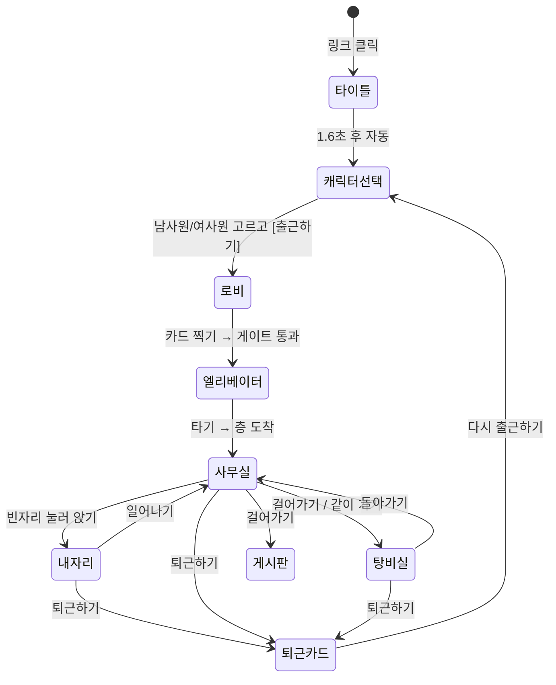
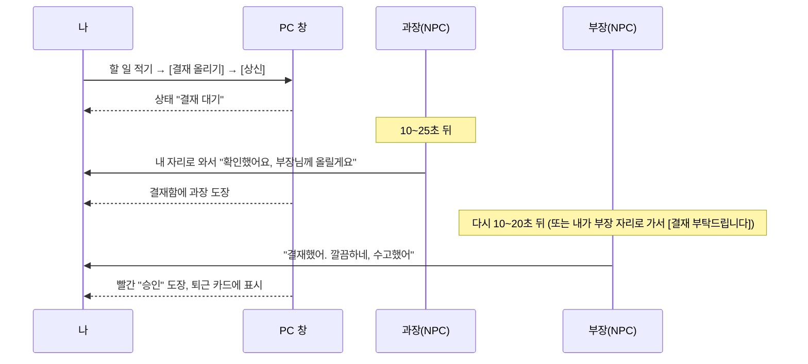

# (주)무한채용 — 출근하기 PRD

> 링크를 누르면 "무한채용 기업 · 출근하기"가 뜨고, 곧바로 회사 1층 로비에 서 있습니다. 사원증을 찍고, 엘리베이터를 타고, 내 부서 빈자리에 앉아 오늘 할 일을 적습니다. 부장님과 과장님이 다가와 말을 걸고, 동료와 탕비실에 가서 커피를 마십니다. [퇴근하기]를 누르면 오늘 일한 시간만큼 시급 10,700원으로 계산한 "오늘의 급여"가 나옵니다.
>
> 이 문서는 외부 AI(코딩 에이전트)가 이것만 보고 만들 수 있도록 썼습니다. 숫자·문구·규칙은 모두 정해진 값이고, 바꿀 수 있는 곳은 **[미정]**으로 표시했습니다.

---

## 0. 한 문장과 지켜야 할 것

**한 문장**: 채용이 얼어붙은 해에, 누구나 아무 조건 없이 "출근"할 수 있는 회사. 출근해서 오늘 진짜로 해야 할 일을 적고, 칭찬받고, 커피 한 잔 하고, 퇴근하는 곳.

**의도는 위로입니다. 놀리지 않습니다.**
- 취업 준비생, 이직 준비생, 쉬고 있는 사람, 혼자 일하는 사람이 "나도 오늘 출근했다"는 기분을 느끼게 하는 것이 목표입니다.
- 부장·과장은 **좋은 상사**입니다. 갑질, 꾸중, 야근 강요, 외모·나이·성별 이야기는 대사에 절대 넣지 않습니다.
- "무한채용"은 "누구든 언제든 뽑는다"는 뜻입니다. 입사 시험, 면접, 탈락은 없습니다.
- 회사 이름, 로고, 건물은 모두 가상입니다. 실제 기업을 떠올리게 하는 이름·로고·색은 쓰지 않습니다.

**하지 않는 것 (v1)**: 회원가입·로그인, 저장(쿠키·localStorage·서버 DB 모두 없음), 음성·영상, 자유 채팅(말은 정해진 버튼과 한 줄 게시판만), 결제, 광고.

---

## 1. 개요

| 항목 | 내용 |
|---|---|
| 제품 | 웹 3D 가상 회사 "(주)무한채용". 폰과 PC 브라우저에서 바로 실행 |
| 주소 | 링크 하나. 들어오면 바로 시작(장소 고르기 없음) |
| 대상 | 취업·이직 준비생, 프리랜서·재택 근무자, "출근하는 기분"이 그리운 사람 |
| 핵심 경험 | ① 출근 의식(카드 찍기, 엘리베이터) ② 내 자리에서 오늘 할 일 적기 ③ 좋은 상사의 칭찬과 결재 ④ 동료와 탕비실 커피 ⑤ 퇴근할 때 오늘의 급여 |
| 정원 | 건물(서버 방 묶음) 하나에 최대 100명 = 부서 5개 × 20명 |
| 화면 | 3D(three.js) + 그 위에 버튼·대화창·PC 화면(HTML) |
| 기록 | 아무것도 저장하지 않음. 새로 들어오면 새 이름, 새 사원증 |

### 화면 흐름 한눈에



[퇴근하기]는 로비를 지난 뒤 어느 화면에서든 오른쪽 위에 늘 있습니다.

---

## 2. 원칙

1. **위로가 먼저**: 모든 문구는 따뜻하게. 상사의 말은 칭찬·걱정·가벼운 부탁뿐입니다.
2. **진짜 내 일**: "오늘의 할 일"은 게임 속 가짜 업무가 아니라 **오늘 실제로 할 일**(예: 이력서 한 군데 내기, 빨래하기)을 적는 칸입니다. 이 내용은 내 화면에만 있고 서버로 보내지 않습니다.
3. **강요 없음**: 같이 가자는 제안은 언제나 거절할 수 있고, 거절해도 아무 일 없습니다.
4. **실제 사람이 우선**: NPC는 빈자리를 채우는 역할입니다. 실제 사람이 오면 NPC가 자리를 비켜 줍니다(5장). 단, 부장·과장은 언제나 NPC입니다.
5. **저장 안 함**: 새로고침하면 처음부터. 이름도 매번 새로.
6. **말은 버튼으로**: 자유 채팅은 없습니다. 대화는 정해진 선택지, 글은 사내 게시판 한 줄(걸러내기 통과)뿐입니다.

---

## 3. 화면별 상세

화면 번호는 시나리오 번호를 따릅니다. 시안 이미지는 `mockups/` 폴더에 같은 번호로 있습니다.

### 화면 0. 타이틀 (0~1.6초)

- 남색 배경 가운데에 작은 글씨 "(주)무한채용"과 큰 글씨 "출근하기", 아래에 얇은 진행 막대.
- 그동안 3D 데이터를 내려받습니다. 받는 동안에도 막대는 끝까지 차고, 준비가 끝나면 1.6초가 지나지 않았어도 0.3초 뒤 로비로 넘어갑니다.
- 버튼 없음. 자동으로 캐릭터 선택 화면으로 넘어갑니다.

### 화면 0-1. 캐릭터 선택 — 남사원 · 여사원

시안 `mockups/00b-select.png`
- 맨 위 가운데: "누구로 출근할까요?"
- 가운데: 두 캐릭터가 나란히 서서 이쪽을 보며 살짝 손을 흔듭니다(3D). 왼쪽은 남사원(짧은 머리, 넥타이), 오른쪽은 여사원(단발).
- 각 캐릭터 얼굴 바로 아래에 이름표 모양 라벨: **남사원**, **여사원**
- 캐릭터를 탭하면 그 캐릭터가 하늘색 동그라미 위로 반 걸음 나오며 고개를 끄덕이고(선택됨), 다른 쪽은 반투명해집니다. 처음에는 아무것도 선택되지 않은 상태입니다.
- 아래: 정장 색 바꾸기 동그라미 5개(남색·차콜·회색·검정·베이지, 기본은 무작위로 하나 선택) — 고른 캐릭터에 바로 입혀집니다.
- 맨 아래 **[출근하기]** 버튼: 캐릭터를 고르기 전에는 회색으로 눌리지 않고, 고르면 하늘색이 됩니다. 누르면 로비로 갑니다.
- 이름(예: 김사원#4821)은 이때 무작위로 정해지고, [출근하기] 위에 작게 "오늘 이름: 김사원#4821"이 보입니다. 다시 뽑기는 없습니다.

### 화면 1. 1층 로비와 출입 게이트

**공간**: 진짜 대기업 본사 1층처럼 **천장이 아주 높은(12m) 로비**입니다. 시안 `mockups/01-lobby-gate.png`.
- 천장: 12m 높이에 큰 사각 조명판이 줄지어 있습니다. 카메라가 내 등 뒤에서 살짝 올려다보게 두어 높이가 느껴지게 합니다.
- 왼쪽: 바닥부터 천장까지 유리 커튼월(창살 기둥 2.4m 간격). 밖은 하늘.
- 오른쪽: 돌벽. 그 앞에 안내 데스크(남색, NPC 1명)와 큰 화분.
- 큰 흰 기둥 4개(지름 1.1m)가 로비를 받칩니다.
- 정면: 스피드 게이트 6줄(기둥 7개, 허리 높이, 유리 날개, 위에 카드 리더).
- 게이트 너머: 엘리베이터 4대가 있는 돌벽 코어. 그 위 5m 높이에 2층 바닥과 유리 난간, 그 위 8m 높이에 큰 회사 로고 "∞ 무한채용"(남색 판). 로고는 "무한" 두 글자를 무한대(∞) 모양으로 감싼 가상 로고입니다.
- 바닥: 밝은 돌 타일(큰 체크).

**NPC**: 정장 입은 직원 NPC 8~12명이 로비를 오갑니다.
- 걷기, 서서 통화하기, 커피 들고 걷기, 게이트 통과하기 중 하나를 합니다.
- 내 쪽으로 오면 살짝 비켜 갑니다.

**조작**: 나는 게이트 앞 6m 지점에서 시작합니다.
- 바닥을 탭하거나 클릭하면 그쪽으로 걸어갑니다(PC는 방향키·WASD도 됨).
- 게이트 1.5m 안에 들어가면 화면 아래에 **[카드 찍기]** 버튼이 뜹니다.

**[카드 찍기]를 누르면**
1. 내 캐릭터가 사원증을 리더기에 갖다 댑니다(0.6초).
2. "삑" 소리와 함께 리더기가 초록색으로 바뀌고, 게이트 날개가 열립니다.
3. 화면 위에 사원증 카드가 1.5초 동안 나타납니다: "신바람기획부 김사원#4821"(부서는 이때 배정, 5장).
4. 나는 게이트를 지나 엘리베이터 홀까지 자동으로 걸어가고, 화면 2로 바뀝니다(검은 화면으로 0.3초 어두워졌다 밝아짐).

### 화면 2. 엘리베이터

- 엘리베이터 문이 열려 있고, 안에 NPC 1~2명이 타 있습니다.
- 한 NPC가 문을 손으로 잡고 다른 손으로 "이리 와" 손짓을 하며 말풍선으로 **"빨리 타!"**라고 합니다.
- 말풍선 대사는 다음 중 무작위입니다: "빨리 타!", "어서 타요, 문 닫혀요!", "타요 타요~", "같이 올라가요!"
- 화면 아래 **[엘리베이터 타기]** 버튼을 누르거나 문 쪽을 탭하면, 내가 뛰어 들어갑니다.
- 안에서 2초: 문이 닫히고 위쪽 층 표시가 1 → 내 부서 층(예: 7층)으로 올라가고 "띵" 소리와 함께 문이 열립니다. 그대로 화면 3으로 이어집니다.
- 부서와 층 대응: 신바람기획부 3층, 두근두근영업부 4층, 차곡차곡재무부 5층, 반짝반짝디자인부 6층, 무럭무럭인사부 7층.

### 화면 3. 부서 사무실

배치도는 `mockups/03b-office-map.png`(실제 장면을 위에서 내려다본 그림)에 있습니다. 엘리베이터에서 내려 유리문을 열면 바로 사무실입니다. 먼발치 가운데에 부장이 앉아 있고, 칸막이마다 사원들이 앉아 있습니다.

**배치** (위에서 본 기준, 문은 아래쪽 가운데)
- 문 바로 앞: 짧은 통로. 왼쪽 벽에 **사내 게시판**, 오른쪽 벽에 탕비실로 가는 문.
- 가운데: **팀 섬 3개**가 문에서 안쪽으로 차례로 놓여 있습니다(문 쪽부터 1팀 → 2팀 → 3팀 → 맨 안쪽 부장). 1팀 7자리, 2팀 7자리, 3팀 6자리로 모두 20자리입니다. 폰 화면이 세로로 길어서, 문에서 들어서면 세 팀과 그 너머 부장이 한눈에 보이도록 이렇게 놓습니다.
  - **진짜 대기업 사무실처럼 칸막이로 나뉜 개인 자리입니다.** 시안 `mockups/03-office.png`, `05-dialog.png`.
  - 팀마다 두 줄이 등을 맞대고 앉습니다(안쪽 줄은 문 쪽을 보고, 문 쪽 줄은 안쪽을 봄). 가운데에 칸막이가 있고, 자리와 자리 사이에도 옆 칸막이가 있어 한 사람씩 ㄷ자 공간을 가집니다.
  - 칸막이: 높이 1.4m, 연보라빛 회색 천(#8f99c6), 가장자리는 밝은 회색 알루미늄 테(#d9dce2).
  - **자리는 넓게**: 캐릭터 머리가 커서 실제 사무실 크기로 만들면 자리가 좁아 보입니다. 자리 하나의 폭은 3.0m, 책상은 2.8 × 1.2(높이 0.72)로 실제의 약 두 배입니다. 의자는 책상 앞쪽 끝에서 1.05m.
  - 자리 하나: 나무색 책상, 오른쪽 아래 3단 서랍장, **모니터 두 대**(0.66m, 살짝 안쪽으로 꺾임), 키보드·마우스, 노트, 머그컵, 칸막이에 붙인 메모지, 파일꽂이, 작은 화분 중 몇 개. 검정 바퀴 의자.
  - 팀 줄 끝 빈 곳에는 복합기나 큰 화분을 둡니다.
  - 앉은 사원은 칸막이 위로 머리와 어깨가 보입니다(캐릭터 머리가 커서 귀엽게 보이는 포인트).
- 바닥: 회색 카펫 타일. 천장: 사각 조명판. 맨 안쪽 벽: 넓은 창문. 오른쪽 벽: 흰 사물함 줄.
- 맨 안쪽 가운데(문 정면, 먼발치): **부장 자리**. 큰 책상, 등받이 높은 의자, 창문을 등지고 사무실을 바라봅니다.
- **과장은 2팀 소속**입니다. 2팀 두 줄의 오른쪽 끝에 팀장 자리(같은 칸막이 자리를 옆으로 돌려 놓음)가 있고, 과장은 거기 앉아 2팀 쪽을 바라봅니다. 따로 떨어진 과장 책상은 없습니다.
- 오른쪽 벽 너머: **탕비실**(6장).

**처음 들어설 때**
- 카메라가 문 위에서 사무실 전체를 1.5초 동안 보여 준 뒤, 내 등 뒤 시점으로 내려옵니다.
- 이때 부장이 고개를 들어 "왔어? 좋은 아침!"(인사 대사 중 무작위, 7장)이라고 말합니다.
- 빈자리 위에는 하늘색 동그라미가 깜빡여서 앉을 수 있는 곳을 알려 줍니다.

**움직이기**: 바닥을 탭하면 걸어갑니다(달리기 없음, 빠른 걸음 1.4m/s). 다른 사람을 탭하면 그 사람 머리 위에 버튼이 뜹니다(8장).

**앉기**: 빈자리 1.2m 안에서 **[자리에 앉기]** 버튼이 뜹니다. 누르면 의자를 빼고 앉아 화면 4로 갑니다.

**화면 위 정보**(왼쪽 위): "신바람기획부 · 3층" / "지금 근무 중 14명" / 근무 시간 "00:12:40"
**오른쪽 위**: [퇴근하기] [조작법] [소리 끔]

### 화면 4. 내 자리와 컴퓨터 — 오늘의 할 일

**시점: 1인칭 3D는 쓰지 않습니다.**
1인칭으로 모니터 속 글씨를 3D로 보여 주면 폰에서 읽기 어렵습니다. 대신 이렇게 합니다.
1. 앉으면 카메라가 내 어깨 너머로 모니터 쪽에 0.6초 동안 다가갑니다.
2. 이어서 화면 가운데에 **모니터 모양의 PC 창(HTML)**이 커지며 뜹니다. 뒤로는 흐릿하게 사무실이 보입니다.
3. [화면 끄기]를 누르면 PC 창이 작아지며 사라지고, 카메라가 다시 내 등 뒤 3인칭(앉은 모습)으로 돌아옵니다. 앉은 채로 주변을 볼 수 있고, 모니터를 탭하면 PC 창이 다시 뜹니다.

**PC 창 구성** (시안 `04-pc-todo.png`)
- **상단 바**: "무한채용 그룹웨어", 오른쪽에 시계(실제 시각), 내 이름.
- **왼쪽 메뉴**: 오늘의 할 일 / 결재함 / 사내 게시판 / 퇴근 기록(오늘).
- **본문 "오늘의 할 일"**
  - 제목 아래 회색 글씨로 "오늘 실제로 해야 할 일을 적어 보세요. 4개까지 적을 수 있어요."
  - 할 일 칸 4개. 한 칸에 30자까지. 예시 문구는 회색으로 무작위 표시: "예) 자기소개서 1번 문항 쓰기", "예) 이력서 한 군데 넣기", "예) 30분 산책하기", "예) 미뤄 둔 메일 답장하기", "예) 방 청소하기", "예) 영어 단어 20개"
  - 칸마다 오른쪽에 버튼 두 개: **[결재 올리기]**, **[완료]**
  - 상태 표시: 적기 전에는 빈칸, 적은 뒤에는 "작성", 결재를 올리면 "결재 대기", 승인되면 빨간 도장 "승인", 완료하면 줄이 그어지고 초록 체크.
- 할 일 내용은 내 기기 메모리에만 있고, 서버에도 기기 저장소에도 저장하지 않습니다. 다른 사람에게는 보이지 않습니다. 단, 내 퇴근 카드에는 나옵니다.

**[결재 올리기]** (진짜 일처럼, 9장)
- 누르면 결재 문서 창이 열립니다. 결재 양식은 제목(할 일), 기안자(나), 결재선 "과장 → 부장", 의견(선택, 30자, 걸러내기)으로 되어 있습니다.
- [상신]을 누르면 "결재 대기"로 바뀝니다.
- 10~40초 뒤 과장이, 그다음 부장이 승인합니다. 결재함에 도장이 하나씩 찍히고, 상사가 내 자리로 와서 한마디 합니다(7장 "결재" 대사).
- 직접 부장 자리로 걸어가 [결재 부탁드립니다]를 눌러도 됩니다(화면 5). 그러면 그 자리에서 바로 도장을 찍어 줍니다.

**[완료]**
- 할 일에 줄이 그어지고 초록 체크가 표시됩니다.
- 3~8초 뒤 과장이나 부장이 다가와 칭찬합니다(7장 "칭찬" 대사).
- 4개를 다 완료하면 부장이 일어나 박수를 치며 "오늘 할 일 다 끝냈네! 최고야. 일찍 퇴근해도 돼"라고 말합니다.

**앉아 있는 동안 화면 아래 버튼**: [화면 켜기/끄기] [일어나기] [퇴근하기]

### 화면 5. 부장·과장 — 다가와서 말 걸기와 대화창

**부장과 과장은 항상 NPC입니다.** 실제 사람이 대신하지 않고, 부서마다 한 명씩 있습니다.
- 부장: 50대 느낌, 회색 정장, 안경. 이름 "최부장"·"한부장" 중 무작위.
- 과장: 30대 느낌, 2팀 팀장. 이름 "박과장"·"윤과장" 중 무작위. 성별은 무작위입니다(여성이면 단발). 시안은 안경 쓴 단발 여성, 검정 정장입니다. 2팀 사람에게는 조금 더 자주(1.5배) 다가옵니다.

**다가오는 때**
- 앉아 있는 동안 2~4분마다 한 번, 부장이나 과장 중 한 명이 내 자리로 걸어와서 말합니다(7장 대사표, 상황에 맞는 묶음에서 무작위).
- 같은 대사는 한 번 출근하는 동안 두 번 나오지 않습니다.
- 내가 PC 화면을 보고 있으면 PC 창 오른쪽 아래에 "○부장님이 다가와요" 알림이 뜨고, 대화창은 PC 창 위에 겹쳐 뜹니다.

**대화창** (시안 `05-dialog.png`)
- 화면 아래쪽 카드에 왼쪽은 상사 얼굴(3D 캐릭터를 잘라 쓴 그림), 이름과 직함, 대사가 있습니다. 대사는 한 글자씩 0.03초 간격으로 나옵니다.
- 그 아래 선택지 버튼 2~3개가 있습니다. 기본은 **[감사합니다] [알겠습니다] [퇴근하겠습니다]**이고, 대사마다 바뀔 수 있습니다(7장).
- 하나를 누르면 상사가 짧게 답하고(7장 "답") 1.5초 뒤 대화창이 닫히며, 상사는 자리로 돌아갑니다.
- [퇴근하겠습니다]를 누르면 상사가 "벌써? …그래, 퇴근은 빠를수록 좋지. 수고했어!"(무작위)라고 답한 뒤 퇴근 카드로 갑니다(화면 8).
- 아무것도 누르지 않으면 12초 뒤 "바쁜가 보네, 나중에 얘기하자" 하고 돌아갑니다.

**내가 상사에게 갈 때**: 부장·과장 1.5m 안에서 머리 위에 버튼이 뜹니다.
- [인사하기]: 상사가 인사 대사를 합니다.
- [결재 부탁드립니다]: 결재 대기 중인 할 일이 있을 때만 뜹니다. 누르면 그 자리에서 도장을 찍어 줍니다.
- [고민 상담]: 위로 대사 중 하나를 듣습니다. 선택지는 [힘이 되네요] [더 버텨 볼게요].

### 화면 6. 탕비실과 커피

**공간**: 사무실 오른쪽 벽 문 너머의 작은 방입니다.
- 커피 머신, 정수기, 간식 바구니(과자·초코바), 작은 냉장고, 둥근 높은 테이블 2개와 의자, 창문(바깥 도시 풍경)이 있습니다.
- 벽에 "오늘도 수고 많으십니다 ☕" 액자가 걸려 있습니다.

**가는 방법**
1. **혼자**: [일어나기]를 누른 뒤 탕비실 문을 탭하면 걸어갑니다. 일어날 때 30% 확률로 근처 상사가 말을 겁니다: "어디 가? 탕비실? 나도 커피 한 잔 해야겠다"(→ [같이 가요] [혼자 다녀올게요]) 또는 "어디 가? 화장실?"(→ [탕비실이요] [바람 좀 쐬려고요]).
   - 상사와 같이 가면, 걷는 동안 상사가 말풍선으로 이런저런 이야기를 3~4줄 합니다(7장 "같이 걸을 때"). 내가 할 일은 없고 듣기만 합니다.
2. **동료와 같이**: 실제 사람이나 NPC 동료를 탭하면 머리 위에 [탕비실 같이 가요]가 뜹니다.
   - 실제 사람에게 누르면 상대 화면에 "○○님이 탕비실 같이 가자고 해요 [같이 가요] [다음에요]"가 뜹니다. 10초 안에 답이 없으면 "다음에요"로 처리합니다.
   - 수락하면 두 사람이 나란히 탕비실로 걸어갑니다. 먼저 제안한 사람이 앞장서고, 함께 달려요의 "같이 뛰기"처럼 상대가 내 옆에 붙어 걷습니다.
   - NPC 동료에게 누르면 80% 확률로 따라오고, 20%는 "지금 마감이라… 다음에 꼭!"이라고 합니다.

**커피 마시기**
- 커피 머신 1m 안에서 [커피 마시기]가 뜹니다. 누르면 고르는 버튼 [아메리카노] [믹스커피] [라떼] [녹차]가 나옵니다.
- 고르면 머신에 컵을 놓고 2초(김이 오르는 연출) 뒤 컵을 들고, 마시는 동작(물 마시기 동작 재사용)을 합니다.
- 토스트로 "따뜻한 아메리카노 한 잔. 잠깐 쉬어 가요"가 뜹니다. 퇴근 카드의 "마신 커피" 수가 1 오릅니다.
- 컵은 들고 다닐 수 있고, 자리에 앉으면 책상에 내려놓습니다.
- 간식 바구니 1m 안에서는 [간식 집기]가 뜨고, 초코바를 하나 먹습니다.
- 탕비실에 다른 사람이 있으면 [건배]가 뜹니다. 컵을 부딪히는 동작이고, 둘 다 "짠!" 말풍선이 뜹니다.

### 화면 7. 사내 게시판

- 사무실 문 옆 왼쪽 벽에 코르크 게시판이 있습니다. 1m 안에서 [게시판 보기]를 누르면 큰 게시판 화면이 뜹니다. PC 창 메뉴에서도 볼 수 있습니다.
- 메모지(포스트잇) 모양 카드에 한 줄씩 붙어 있습니다. 같은 건물(100명)의 모든 부서가 함께 보는 게시판입니다.
- [한 줄 남기기]
  - 입력칸 안내: "하고 싶은 말을 한 줄 남겨 보세요".
  - 회색 예시(무작위): "예) 오늘 면접 보고 왔어요. 다들 힘내요", "예) 3번째 출근, 이제 좀 익숙해요", "예) 다음 주에 첫 출근합니다!", "예) 커피 맛집은 4층 탕비실"
  - 아래 작은 안내: "욕설·비방·광고·연락처는 올릴 수 없어요".
- 30자까지, 한 사람이 출근 한 번에 3개까지 올릴 수 있습니다.
- 게시판에는 최근 40개만 보입니다. 서버 메모리에만 있고, 방(건물)이 비면 사라집니다(저장 안 함).
- 각 메모 길게 누르기 → [신고]. 신고가 3번 모이면 모두에게서 가려집니다.
- 걸러내기는 함께 달려요의 한 줄 걸러내기(욕설·변형 욕설·연락처·광고·위기 단어)를 그대로 씁니다(10장).
- NPC도 메모를 남긴 것처럼 미리 8개가 붙어 있습니다. 예시 문구 목록에서 고릅니다.

### 화면 8. 퇴근 카드 — 오늘의 급여

[퇴근하기]를 누르면 바로 나오지 않고, 먼저 확인 창이 뜹니다: "오늘 업무를 마치고 퇴근할까요? [퇴근하기] [조금 더 일할게요]"
- 퇴근하기를 누르면 내 캐릭터가 일어나 가방을 메고 손을 흔들고(1초), 근처 상사가 "수고했어! 내일 보자"라고 합니다.
- 화면이 어두워지고 퇴근 카드가 뜹니다. 시안은 `08-payslip.png`입니다.

**퇴근 카드 = 급여 명세서 모양**
- 맨 위: "오늘도 출근 완료" 도장, 회사 로고, 날짜.
- 이름과 부서: "신바람기획부 김사원#4821"
- **근무 시간**: 로비에서 [카드 찍기]를 누른 때부터 [퇴근하기]까지. "2시간 34분"처럼 표시합니다.
- **오늘의 급여**(가장 큰 글씨): 30분 단위로 계산합니다.
  - 계산식: `급여 = floor(근무 분 ÷ 30) × 5,350원` (시급 10,700원 ÷ 2, 운영자 결정 2026-11-11)
  - 예: 29분 → 0원, 30분 → 5,350원, 2시간 34분 → 5 × 5,350 = 26,750원
  - 아래 작은 글씨: "시급 10,700원 기준, 30분 단위"
  - 30분이 안 됐으면 "30분을 채우면 5,350원이 쌓여요. 다음엔 조금만 더 있다 가요"라고 보여 줍니다.
  - 시급은 설정값 하나(`HOURLY_WAGE = 10700`)로 두어 나중에 바꾸기 쉽게 합니다.
- **오늘 한 일**: 적은 할 일 목록. 승인 도장, 완료 체크 표시가 함께 나옵니다.
- 마신 커피 n잔, 같이 일한 사람 n명(같은 부서의 실제 사람 + NPC), 받은 칭찬 n번
- **오늘의 한마디**: 아래 목록에서 무작위로 고릅니다.
  - "오늘도 출근한 당신, 그것만으로 충분히 잘했어요"
  - "적어 둔 일 하나만 해도 오늘은 성공이에요"
  - "어디에 있든, 오늘 당신은 일하는 사람이었어요"
  - "쉬어 가는 날도 출근한 날이에요"
  - "내일 자리는 비워 둘게요. 언제든 다시 출근하세요"
  - **[미정]** 30개까지 함께 확정
- 버튼: **[결과 이미지 저장]**(9:16 이미지, 함께 달려요와 같은 방식: 일반 브라우저는 내려받기, 아이폰과 앱 안 브라우저는 길게 눌러 저장), **[다시 출근하기]**(캐릭터 선택부터, 새 이름으로).
- 링크·글 공유 버튼은 없습니다.

---

## 4. 캐릭터

말랑한 비닐 장난감 느낌의 2등신 3D 캐릭터입니다. 시안 `mockups/09-characters.png`가 기준이고, 그린 코드는 `reference-code/toon.js`의 `worker()`입니다(만드는 규칙은 14장).
**함께 달려요의 러닝 캐릭터 몸은 쓰지 않습니다.** 그 몸은 여러 도형을 녹여 붙인 표면이라, 가까이서 보면 몸통이 울퉁불퉁해 보입니다.

| | 남사원 | 여사원 |
|---|---|---|
| 머리 | 옆으로 넘긴 짧은 머리 + 정수리 삐침 한 가닥 | **단발**(턱선 길이, 일자 앞머리) |
| 옷 | 정장 재킷 + 흰 셔츠 + 넥타이 + 정장 바지 + 구두 | 정장 재킷 + 흰 블라우스(브로치) + 정장 바지 + 구두 |
| 정장 색 | 남색 · 차콜 · 회색 · 검정 · 베이지 · 분홍 | 같음 |
| 넥타이 색 | 빨강 · 파랑 · 초록 · 노랑 중 무작위 | (없음) |
| 사원증 | 왼쪽 가슴, 파란 목줄 | 같음 |

- 부장은 대머리에 회색 옆머리, 둥근 안경, 회색 정장입니다. 과장(2팀 팀장)은 시안에서 단발에 안경, 검정 정장입니다. NPC 사원은 위 표의 조합을 무작위로 쓰고, 일부는 안경을 씁니다.
- 내 캐릭터는 캐릭터 선택 화면(화면 0-1)에서 남사원·여사원 중에 고르고, 정장 색도 고를 수 있습니다. 넥타이 색은 무작위입니다.
- 이름은 성씨 + "사원" + #네 자리 숫자입니다. 예: 김사원#4821, 이사원#0373. 성씨는 흔한 성 20개 중 무작위입니다.
- 동작은 서기, 걷기, 앉기(의자), 타자 치기(앉아서 손가락이 움직임), 마시기, 손 흔들기, 박수, 손짓하기(엘리베이터), 카드 찍기, 인사(고개 숙이기), 기지개를 씁니다.

---

## 5. 부서·자리 배정과 NPC 교체

### 부서 5개 (건물 하나 = 서버 방 묶음 하나, 최대 100명)

| 부서 | 층 | 팀(자리 수) | 분위기 소품 |
|---|---|---|---|
| 신바람기획부 | 3층 | 1팀 7 · 2팀 7 · 3팀 6 = 20 | 화이트보드, 포스트잇 |
| 두근두근영업부 | 4층 | 같음 | 실적 그래프 액자(전부 상승) |
| 차곡차곡재무부 | 5층 | 같음 | 계산기, 서류철 |
| 반짝반짝디자인부 | 6층 | 같음 | 색 견본, 큰 모니터 |
| 무럭무럭인사부 | 7층 | 같음 | 화분이 유난히 많음 |

### 배정 규칙 (카드를 찍는 순간)
1. 실제 사람이 1명 이상 있고 자리가 남은 부서 중에서 무작위로 고릅니다. 사람끼리 만나게 하려는 규칙입니다.
2. 그런 부서가 없으면(모든 부서가 비었으면) 5개 부서 중 무작위로 고릅니다.
3. 부서 안 자리: 빈자리(NPC가 앉은 자리 포함) 중 실제 사람 옆자리를 먼저 고릅니다. 앉는 곳은 내가 고를 수 있습니다. 하늘색 동그라미는 추천일 뿐입니다.
4. 5개 부서가 모두 실제 사람 20명이면(=100명) 건물이 가득 찬 것입니다. 이때는 타이틀에서 "오늘은 자리가 꽉 찼어요. 잠시 후 다시 출근해 주세요"를 보여 주고, 30초마다 다시 시도합니다.
   - **[미정]** 건물을 2동, 3동으로 늘리는 설정값(`MAX_BUILDINGS`)을 둡니다. 함께 달려요의 `MAX_ROOMS`와 같은 방식입니다.

### NPC 사원 (부서마다 기본 10명)
- 부서 20자리 중 10자리에 NPC가 앉아 있습니다. 나머지 10자리는 비어 있습니다.
- 실제 사람이 들어오면 먼저 빈자리에 앉습니다. 빈자리가 다 차면 NPC 자리에 앉을 수 있고, 그 NPC는 비켜 줍니다.
- **NPC가 빠지는 방식**(눈앞에서 사라지지 않게)
  - 실제 사람이 부서에 들어오면, 30초에 한 명씩 NPC 하나가 일어나 "외근 다녀오겠습니다" / "회의 들어가요" / "은행 좀 다녀올게요" 중 하나를 말하고 문으로 걸어 나간 뒤 사라집니다.
  - 목표 NPC 수 = max(0, 10 − 그 부서의 실제 사람 수). 실제 사람이 10명 이상이면 NPC 사원은 0명입니다(부장·과장은 남음).
  - 실제 사람이 나가면 15초에 한 명씩 NPC가 문으로 들어와 빈자리에 앉습니다.
  - 실제 사람이 NPC가 앉은 자리를 고르면, 그 NPC는 즉시 일어나 "아, 여기 앉으세요!" 하고 다른 빈자리로 옮겨 갑니다. 빈자리가 없으면 "외근 다녀올게요" 하고 나갑니다.
- NPC 사원의 행동: 타자 치기(대부분), 기지개, 전화받기, 탕비실 다녀오기(5~8분에 한 번), 옆자리와 고개 돌려 이야기하기(말풍선 없음). 가끔 사내 게시판 앞에 서 있습니다.
- NPC와 실제 사람은 겉으로 구별되지 않습니다. 대신 조작법 카드 맨 아래에 "사무실에는 자동으로 일하는 동료도 함께 있어요"를 작게 적습니다.
- 부서 인원 표시("지금 근무 중 14명")는 실제 사람 + NPC 사원 + 부장·과장 2명입니다.

---

## 6. 공간 크기와 카메라

| 공간 | 크기(대략, m) | 비고 |
|---|---|---|
| 로비 | 24 × 34, 천장 12 | 게이트 6개는 문에서 14m 지점, 엘리베이터 홀은 게이트 뒤 6m |
| 엘리베이터 안 | 2.4 × 2.4 | 문 쪽을 바라보는 고정 카메라 |
| 부서 사무실 | 18 × 30, 천장 3.1 | 팀 하나 = 칸막이 자리 두 줄(자리 3.0 간격, 한 줄 최대 4자리), 팀 사이 6.6. 2팀 오른쪽 끝에 과장(팀장) 자리. 부장 자리는 맨 안쪽 벽 앞 |
| 탕비실 | 7 × 6 | 사무실 오른쪽 벽 문으로 연결 |

- 카메라: 내 등 뒤 위쪽 3인칭으로 나를 따라다닙니다. 함께 달려요처럼 한 손가락 끌기와 마우스 끌기로 돌리고, 두 손가락이나 휠로 확대합니다. [원래 시점] 칩도 있습니다.
- **폰(세로)과 PC(가로)는 보이는 넓이가 다릅니다.** 시안 `03-office.png`(폰)와 `pc-03-office.png`(PC).
  - 폰: 가까이 잡아서 내 주변 자리 2~3개 폭만 보입니다(시야각 54°, 나에게서 높이 8, 뒤로 9). 멀리 부장 자리까지는 보입니다.
  - PC: 화면이 가로로 길어서 높이 올려 사무실 전체가 보이게 합니다(시야각 46°, 높이 15, 뒤로 16).
  - 화면 비율이 바뀌면(폰을 눕히는 경우 포함) 바로 바꿉니다.
- PC 조작: 바닥 클릭으로 걷기, 다른 사람 클릭으로 버튼, `E` 앉기·일어나기, `Space` 카드 찍기, `Esc` PC 창 닫기. 버튼 묶음은 오른쪽 아래(폭 360px), 폰에서는 아래 가운데 전체 폭.
- 칸막이와 벽이 카메라를 가리면 그 부분을 반투명(불투명도 0.25)하게 만듭니다.
- 앉은 상태에서는 내 어깨 너머 시점이고, PC 창을 켜면 모니터 쪽으로 다가갑니다.
- 조명: 낮 시간대 형광등의 밝고 따뜻한 흰색입니다. 창밖 하늘은 실제 시각을 따라 아침, 낮, 저녁, 밤으로 바뀝니다(함께 달려요 하늘 재사용). 밤이면 창밖으로 도시 야경이 보입니다.

---

## 7. NPC 대사표

규칙
- `{이름}` = 내 이름에서 성 + "사원님"(예: 김사원님). `{할일}` = 내가 적은 할 일 중 하나(10자 넘으면 앞 10자 + "…").
- 묶음마다 무작위이고, 한 번 출근하는 동안 같은 대사는 다시 나오지 않습니다.
- 선택지를 따로 적지 않은 대사는 기본 선택지 [감사합니다] [알겠습니다] [퇴근하겠습니다]를 씁니다.
- 기본 선택지의 답: 감사합니다 → "그래그래 ㅎㅎ" / "고맙긴, 내가 고맙지" / 알겠습니다 → "좋아, 무리는 하지 말고" / "천천히 해도 돼" / 퇴근하겠습니다 → "벌써? …그래, 퇴근은 빠를수록 좋지. 수고했어!" / "오 칼퇴! 부럽다. 조심히 가"

### 7-1. 인사 (사무실에 처음 들어올 때, [인사하기])
| 누가 | 대사 |
|---|---|
| 부장 | 왔어? 좋은 아침! |
| 부장 | 오늘도 출근했네. 그게 제일 어려운 거야, 잘했어 |
| 부장 | 커피는 마셨고? 탕비실에 원두 새로 들어왔어 |
| 과장 | {이름}, 오늘 컨디션 어때요? |
| 과장 | 어서 와요! 자리 편한 데 앉아요 |
| 과장 | 출근길 춥지 않았어요? |

### 7-2. 업무 독려 (앉아 있을 때 2~4분마다)
| 누가 | 대사 | 선택지 |
|---|---|---|
| 부장 | 업무 열심히 해~ 근데 무리는 하지 말고 | 기본 |
| 부장 | '{할일}' 그거 오늘 안에 부탁할게. 급한 건 아니야 | [알겠습니다] [오늘 꼭 할게요] [퇴근하겠습니다] |
| 과장 | '{할일}' 금요일까지만 부탁해요. 막히면 말하고 | [알겠습니다] [도와주세요] → "그럼 같이 보자. 일단 첫 줄만 써 봐요" |
| 부장 | 집중하는 모습 보기 좋다 | 기본 |
| 과장 | 한 시간 했으면 5분은 쉬어요. 그것도 일이에요 | [감사합니다] [탕비실 다녀올게요] → 탕비실로 걸어감 |
| 부장 | 오늘 할 일 적었어? 적는 것부터가 시작이야 | 기본 |
| 과장 | 모니터 너무 가까이 보지 말고요, 눈 아파요 | 기본 |

(할 일을 하나도 안 적었으면 `{할일}` 대사 대신 "오늘 할 일부터 하나 적어 볼까? 작은 거라도 좋아"가 나옵니다.)

### 7-3. 칭찬 ([완료] 뒤, 결재 승인 때)
| 누가 | 대사 |
|---|---|
| 부장 | 오, 벌써 끝냈어? 역시 {이름} |
| 부장 | 결재했어. 깔끔하네, 수고했어 |
| 과장 | '{할일}' 완료! 오늘 한 건 했네요 |
| 과장 | 이 정도면 오늘 밥값 했어요 ㅎㅎ |
| 부장 | 하나씩 해내는 게 제일 멋진 거야 |
| 부장 (4개 다 완료) | 오늘 할 일 다 끝냈네! 최고야. 일찍 퇴근해도 돼 |

### 7-4. 걱정과 위로 ([고민 상담], 오래 앉아 있을 때)
| 대사 | 선택지 → 답 |
|---|---|
| 요즘 많이 힘들지? 다 지나가더라, 진짜로 | [힘이 되네요] → "언제든 얘기해" / [더 버텨 볼게요] → "버티는 것도 실력이야" |
| 나도 서류 서른 군데 떨어지고 여기 들어왔어. 너도 돼 | 같음 |
| 얼굴이 좀 피곤해 보이는데, 잠깐 쉬었다 해 | [감사합니다] / [탕비실 다녀올게요] |
| 오늘 아무것도 못 해도 괜찮아. 출근한 걸로 됐어 | [힘이 되네요] / [그래도 하나는 할게요] → "그 마음이면 충분해" |
| 비교하지 마. 다들 자기 속도로 가는 거야 | 같음 |

### 7-5. 일어날 때 (30% 확률)
- "어디 가? 탕비실? 나도 커피 한 잔 해야겠다" → [같이 가요] / [혼자 다녀올게요] → "그래, 다녀와~"
- "어디 가? 화장실?" → [탕비실이요] → "가는 김에 내 것도… 농담이야 ㅎㅎ" / [바람 좀 쐬려고요] → "좋지, 금방 와"

### 7-6. 같이 걸을 때 (탕비실까지, 말풍선 3~4줄 차례로)
- "나 신입 때는 말이야… 아니다, 라떼 얘기는 그만할게 ㅎㅎ"
- "요즘 점심 뭐 먹어? 나는 김치찌개만 3일째야"
- "주말에 뭐 해? 쉬는 것도 계획이 필요하더라"
- "우리 회사 탕비실 믹스커피가 은근 맛집이야"
- "회사 앞에 붕어빵 생겼던데, 퇴근할 때 사 가"
- "예전에 발표하다가 슬라이드를 거꾸로 띄운 적이 있어. 다들 기억 못 하더라, 괜찮아"

### 7-7. 엘리베이터 NPC
"빨리 타!" / "어서 타요, 문 닫혀요!" / "타요 타요~" / "같이 올라가요!" / (안에서) "몇 층 가요? 아, 같은 층이네요"

### 7-8. NPC 사원이 비켜 줄 때
"외근 다녀오겠습니다" / "회의 들어가요" / "은행 좀 다녀올게요" / "아, 여기 앉으세요!"

**[미정]** 대사를 묶음마다 2배로 늘린 최종 목록(100줄 안팎)은 따로 확정합니다. 위 문장은 톤 기준입니다.

---

## 8. 사람끼리 (실제 사람 ↔ 실제 사람)

다른 사람을 탭하면 머리 위에 버튼이 뜹니다. 함께 달려요의 "옆 사람 버튼"과 같은 방식입니다.

| 버튼 | 조건 | 일어나는 일 |
|---|---|---|
| [인사하기] | 3m 안 | 고개 숙여 인사합니다. 상대 화면에도 그 사람이 내게 인사하는 모습이 보이고, "○○님이 인사했어요" 토스트가 뜹니다 |
| [탕비실 같이 가요] | 3m 안, 둘 다 서 있음 | 6장 참고(수락하면 나란히 걸어감) |
| [박수] | 언제나 | 상대 쪽을 보고 박수를 칩니다. 할 일을 완료한 동료에게 쓰라고 있는 버튼입니다 |
| [건배] | 탕비실, 둘 다 컵을 듦 | 컵을 부딪칩니다 |

- 누가 [완료]를 누르면 같은 부서 사람들 화면에 "○○님이 할 일을 하나 끝냈어요"가 작게 뜹니다. 할 일 내용은 보내지 않습니다. 그 사람 머리 위에는 2초 동안 체크 표시가 뜹니다.
- 받은 인사, 박수, 건배 수는 퇴근 카드의 "받은 응원"에 들어갑니다.

---

## 9. 결재 흐름



- 결재는 전부 내 기기 안에서 일어나는 연출입니다. NPC는 각자 기기에서 움직이므로 서버를 거치지 않습니다.
- 동시에 결재 대기는 4개까지(할 일 수만큼)입니다.
- 반려는 없습니다(위로가 먼저).

---

## 10. 안전·운영

- **글을 쓰는 곳은 두 곳뿐입니다**
  - 오늘의 할 일: 내 화면에만 있고, 서버로 보내지 않으므로 거르지 않습니다.
  - 사내 게시판 한 줄과 결재 의견: 걸러냅니다. 결재 의견은 서버로 보내지 않지만, 퇴근 이미지에 들어갈 수 있어서 거릅니다.
- **걸러내기**: 함께 달려요의 `lineFilter`와 `words`를 그대로 씁니다. 기기에서 한 번, 서버에서 한 번 더 검사합니다.
  - 욕설과 그 변형(띄어쓰기, 숫자 끼워 넣기, 영문 자판으로 친 한글)
  - 비방, 광고, 연락처(전화번호, 링크, 메신저 아이디)
  - 걸리면 "그 말은 올릴 수 없어요" 또는 "연락처·링크·숫자는 올릴 수 없어요"를 보여 줍니다.
- **위기 단어**(자해·자살 관련): 게시판에 올리지 않고, 쓴 사람 화면에만 도움 안내를 보여 줍니다. 자살예방상담전화 109, 정신건강위기상담 1577-0199.
- **신고**: 게시판 메모 길게 누르기 → [신고]. 3명이 신고하면 모두에게서 가려집니다.
- **기록 없음**: 서버 로그 저장을 끕니다. 게시판도 메모리에만 둡니다.
- **동시 접속**: 건물 하나 100명. 넘치면 타이틀에서 안내합니다.

---

## 11. 기술 구성

함께 달려요(run 2gether)와 같은 구조입니다. 그 코드를 쓸 수 있으면 아래 "가져올 것"을 그대로 가져옵니다.

| 부분 | 기술 |
|---|---|
| 화면 | Vite + TypeScript(strict) + three.js r149. 3D 위에 HTML 버튼·대화창·PC 창 |
| 서버 | Cloudflare Workers(정적 파일) + Durable Objects(실시간 방, WebSocket Hibernation) |
| 방 | 부서 하나 = Durable Object 하나(정원 20). 이름 `b{건물}-{부서}`. 건물 대기열은 Worker가 5개 부서 인원을 보고 정함 |
| 저장 | 없음. 이름, 할 일, 기록 모두 기기 메모리에만 |
| 배포 | 저장소 `blakelee0708/company`, Cloudflare Worker 이름 `company`(연결 완료). main에 푸시하면 `npx wrangler deploy`로 자동 배포. 주소 https://company.play-run.workers.dev |

**함께 달려요에서 가져올 것**
- 동작 엔진과 IK(`anim/`) — 몸은 가져오지 않음(4장)
- 카메라: 돌리기와 확대(`game/view.ts`)
- 방 서버 뼈대(`server/crowdRoom.ts`): 입장, 퇴장, 위치 묶어 보내기(200ms), 이벤트 중계, 신고
- 한 줄 걸러내기(`shared/lineFilter.ts`, `shared/words.ts`)
- 결과 이미지 만들기와 저장(`ui/share.ts`)
- 이름 만들기, 하늘(시간대)
- 입장 속도 최적화: 글꼴·텍스처 미리 받기(preload), 실제 사이트에서 셰이더 오류 검사 끄기

**새로 만들 것**
- **캐릭터**: `reference-code/toon.js`의 `worker()`를 출발점으로 씁니다. 몸통은 회전체 하나(셔츠 V·넥타이·라펠·단추는 셰이더로 표면에 칠함), 팔은 어깨 안쪽에서 시작해 이음매 없이 휘는 관, 머리카락은 머리보다 조금 큰 공을 머리선 아래에서 안으로 밀어 넣은 닫힌 면입니다. 움직일 때는 이 조각들을 뼈대(SkinnedMesh)에 붙이거나, 팔 관을 매 프레임 다시 만듭니다(조각이 몇 개 안 돼 가볍습니다)
- 로비, 엘리베이터, 사무실, 탕비실 장면. 함께 달려요의 러닝머신식 길과 달리 고정된 방이고, 바닥 탭으로 이동합니다
- 의자 앉기, 타자 치기, 카드 찍기, 손짓, 인사, 컵 들기 동작
- 걷기 길 찾기: 책상과 칸막이를 피해 걷는 격자 A* 경로(0.5m 칸)
- NPC 상태 기계: 부장·과장(자리 → 걸어오기 → 말하기 → 돌아가기), 사원(타자 → 쉬기 → 탕비실), 엘리베이터 NPC, 로비 NPC
- PC 창(할 일 4칸, 결재함, 게시판, 오늘 기록), 대화창, 퇴근 카드
- 근무 시간·급여 계산

### 실시간 메시지 (부서 방)

보내는 것 (나 → 방)

| t | 내용 |
|---|---|
| `hi` | 이름, 성별, 정장 색, 넥타이 색 |
| `s` | 위치 x, z, 바라보는 방향, 상태(서기·걷기·앉기·탕비실), 앉은 자리 번호(없으면 -1), 컵 듦 여부. 움직일 때 1초에 3번, 앉아 있으면 상태가 바뀔 때만 |
| `e` | 이벤트: `bow`(인사), `clap`, `cheers`(건배), `done`(할 일 완료, 내용 없음), `ask`/`yes`/`no`/`apart`(탕비실 같이 가기), `drink` |
| `seat` | 이 자리에 앉겠다(번호). 방이 먼저 온 사람에게 줌 |
| `note` | 게시판 한 줄(방에서 다시 걸러냄) |
| `report` | 게시판 메모 신고 |

받는 것 (방 → 나): `welcome`(내 id, 다른 사람들, 자리표, 게시판), `join`, `leave`, `snap`(모두의 위치 묶음, 최대 200ms마다), `e`, `seats`(자리표: 자리마다 실제 사람 id 또는 비어 있음), `note`, `hide`(신고로 가려짐), `full`

- **게시판은 건물 전체가 함께 봅니다**: 부서 방 5개가 서로 메모를 전달하거나, 건물마다 게시판 전용 Durable Object를 하나 둡니다(추천).
- NPC는 서버에 없습니다. 각 기기가 자리표(실제 사람이 앉은 자리)를 보고 같은 규칙(5장)으로 NPC를 그립니다. 그래서 기기마다 NPC 모습이 조금 달라도 괜찮습니다.

### 파일 구조 (추천)
```
src/
  core/      상태, 상수(급여·시간·정원), 장면·카메라, 유틸
  character/ 몸, 정장·단발, 사원증, 동작
  anim/      기본 동작(서기·걷기·앉기·타자), 상체 동작(인사·박수·손짓·마시기·카드 찍기)
  world/     lobby.ts, elevator.ts, office.ts, pantry.ts, 길 찾기 격자
  npc/       boss.ts(부장·과장), staff.ts(사원), lobby.ts, lines.ts(대사표)
  ui/        title, buttons, dialog, pc(할 일·결재함·게시판), payslip(퇴근 카드), guide
  net/       room.ts(연결), peers.ts(다른 사람 그리기)
  shared/    protocol.ts, lineFilter.ts, words.ts, pay.ts(급여 계산)
  server/    worker.ts, deptRoom.ts, boardRoom.ts
tests/       단위 테스트(급여, 배정, 대사 규칙, 걸러내기), e2e(Playwright)
```

### 성능 기준
- 중급 폰에서 30fps 이상. 화면에 사람은 최대 22명(부서 20 + 부장·과장)입니다.
- 입장(타이틀 → 로비 조작 가능)까지 4G에서 5초 안.
- 칸막이, 책상, 모니터, 의자는 같은 모양을 여러 번 그리는 방식(InstancedMesh)으로 그립니다. 자리가 20개라 모니터만 40대입니다.

---

## 12. 개발 단계와 완료 기준

| 단계 | 내용 | 완료 기준 |
|---|---|---|
| 1. 캐릭터 | 정장 남·여(단발), 사원증, 앉기·타자·카드 찍기·손짓 동작 | 캐릭터 뷰어에서 모든 동작이 어색하지 않음(손이 얼굴이나 몸을 뚫지 않음) |
| 2. 혼자 출근 | 타이틀 → 캐릭터 선택 → 로비(카드 찍기) → 엘리베이터 → 사무실 → 앉기 → PC 할 일 4칸 → 퇴근 카드(급여) | 처음부터 끝까지 막힘 없이 됨, 급여 계산 테스트 통과 |
| 3. 상사 NPC | 부장·과장 걸어오기, 대화창, 대사표, 결재 흐름, 일어날 때 말 걸기, 같이 걷기 | 30분 앉아 있는 동안 같은 대사가 두 번 나오지 않음, 결재 도장 두 개 |
| 4. 탕비실 | 커피 머신, 간식, 건배, 혼자·상사와 가기 | 커피 4종 마시기, 퇴근 카드에 잔 수 |
| 5. 같이 출근(실시간) | 부서 방, 자리표, 배정 규칙, NPC 교체, 인사·박수·탕비실 같이 가기, 게시판 | 두 기기가 같은 부서에서 서로 보임, 탕비실 같이 가기 수락·거절 둘 다 됨, 가상 사용자 120명 부하 테스트(부서마다 20명, 넘치면 안내) |
| 6. 마무리 | 조작법 카드, 결과 이미지 저장, 입장 속도, 미리보기 이미지(og:image) | 폰(앱 안 브라우저 포함)에서 결과 이미지 저장, 4G 5초 안 입장 |

**테스트로 꼭 확인할 숫자**
- 급여: 0분 → 0원, 29분 → 0원, 30분 → 5,350원, 59분 → 5,350원, 60분 → 10,700원, 154분 → 26,750원
- 배정: 사람 있는 부서 우선, 모든 부서 20명이면 가득 참
- NPC 사원 수 = max(0, 10 − 실제 사람 수), 30초에 한 명씩만 빠지고 15초에 한 명씩만 들어옴
- 걸러내기: "시1발", "010 1234 5678", "tlqkf"는 막히고, "오늘 면접 봤어요"는 통과

---

## 13. 미정 사항

1. 대사 최종 목록(묶음마다 2배, 100줄 안팎)과 퇴근 카드 한마디 30개
2. 부서 이름 5개 확정(지금은 신바람기획부, 두근두근영업부, 차곡차곡재무부, 반짝반짝디자인부, 무럭무럭인사부)
3. 시급(10,700원)을 해마다 바꿀지
4. 실제 시각에 따른 이벤트를 넣을지(점심시간 12~13시에는 부장이 "점심 먹고 해!", 18시 이후에는 "퇴근 안 해? 얼른 가")
5. 주소(도메인)와 서비스 이름 표기: "(주)무한채용"과 "무한채용 기업" 중 무엇을 쓸지
6. 함께 달려요와 연결할지(퇴근 카드에 "퇴근길에 한강 한 바퀴?" 링크)

---

## 14. 3D 그림 규칙 (시안과 똑같이 맞출 것)

시안은 모두 `reference-code/`의 three.js 코드로 그린 것입니다. AI 그림이 아니므로 같은 코드로 그대로 다시 그릴 수 있습니다.

- **느낌**: 말랑한 비닐 장난감. 재질은 `MeshStandardMaterial`(거칠기 0.6 안팎, 금속 0), 방 반사(RoomEnvironment) 약하게, 색 보정(톤 매핑) 없음.
- **몸이 울퉁불퉁하지 않게**: 몸은 매끈한 도형 몇 개로만 만듭니다(공·캡슐·회전체·관). 여러 도형을 녹여 붙이는 방식(SDF·마칭 큐브)은 쓰지 않습니다.
- **팔다리가 떨어져 보이지 않게**: 팔은 어깨 안쪽(몸통 속)에서 시작하는 관 하나로 팔꿈치까지 휘어 내려오고, 손은 공입니다. 다리는 재킷 밑단 속에서 시작하는 캡슐입니다.
- **줄무늬 없게**: 캐릭터는 그림자를 드리우기만 하고 받지 않습니다(`receiveShadow = false`). 바닥과 가구만 그림자를 받습니다.
- **비율**: 키 약 1.5(머리 가로 반지름 0.43, 세로 0.39, 머리 중심 높이 1.0). 장면에서는 1.22배로 키워 잘 보이게 합니다.
- **얼굴**: 세로로 긴 검은 눈(반짝이 2개), 볼은 분홍, 작은 웃는 입. 얼굴과 손은 같은 살색(#ffdcc6).
- **색**: 정장 남색 #33467a · 차콜 #4a4e58 · 회색 #8a91a0 · 검정 #2c2e35 · 베이지 #dcc29b · 분홍 #e9a9b4. 칸막이 천 #8f99c6, 테 #d9dce2, 책상 #dcb47c. 회사 남색 #1d2b4f, 켜진 버튼 하늘색 #8fd3ff, 도장 빨강 #d23b3b.
- **로비**: 천장 12m, 유리 커튼월, 큰 기둥, 2층 난간, 높은 로고(화면 1).
- **사무실**: 칸막이 개인 자리 + 듀얼 모니터(화면 3).

---

## 15. 시안 그래픽 그대로 만드는 순서

외부 AI(개발자)가 시안과 같은 그림을 얻는 가장 빠른 길입니다.

1. `reference-code/` 폴더에서 `python3 -m http.server 8000`을 켜고 `http://localhost:8000/mockups.html`을 엽니다. 시안 PNG와 똑같은 화면이 브라우저에서 그려지는지 먼저 확인합니다.
2. 아래 파일을 TypeScript로 옮깁니다. 숫자(크기·위치·색)는 그대로 둡니다.
   - `toon.js`의 `worker()` → `src/character/worker.ts` (캐릭터)
   - `clay.js` → `src/core/render.ts` (렌더러 설정, 빛, 그림자: 캐릭터는 그림자를 받지 않음)
   - `scenes4.js`의 `lobby()`, `elevator()`, `office()`, `pantry()` → `src/world/*.ts` (장면). `cubicle()`·`monitor()`·`chair()`는 InstancedMesh로 바꿔도 모양은 같게
3. 카메라는 폰·PC 값(6장)을 씁니다. 그다음 바닥 탭 이동, 앉기, NPC를 붙입니다.
4. 단계마다 Playwright로 같은 장면을 캡처해 `mockups/`의 같은 이름 PNG와 나란히 놓고 비교합니다(특히 `09-characters.png`, `03-office.png`, `pc-03-office.png`, `01-lobby-gate.png`). 몸이 울퉁불퉁하거나, 팔다리가 떨어져 보이거나, 자리가 좁아 보이면 다시 고칩니다.
